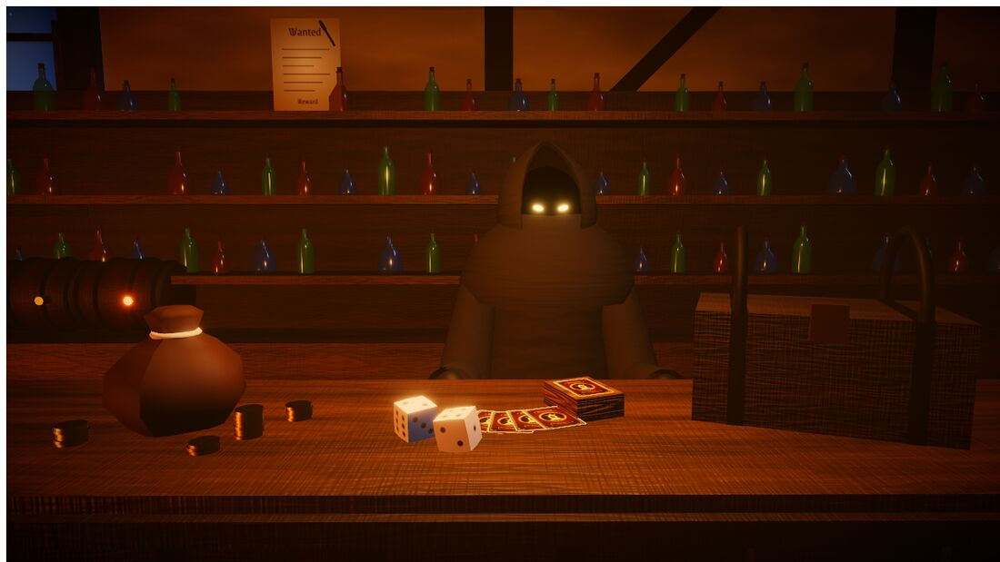
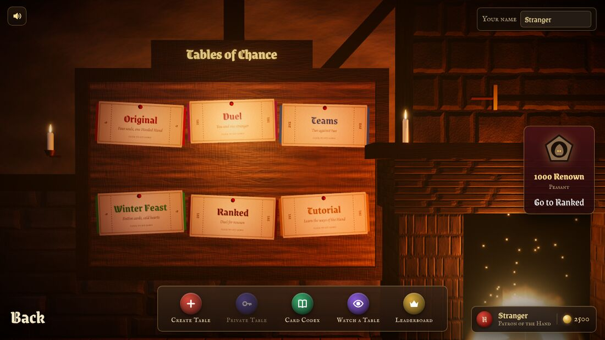
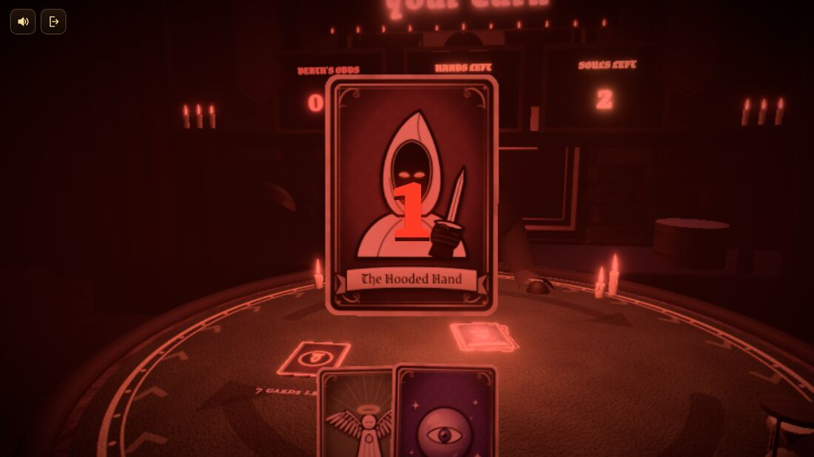
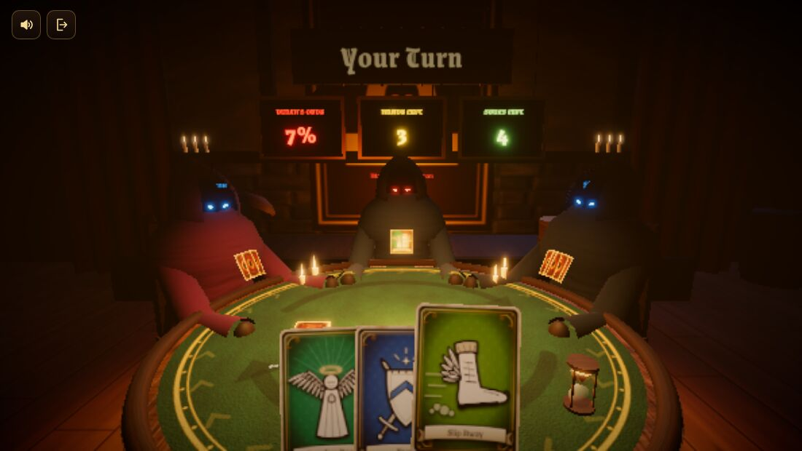
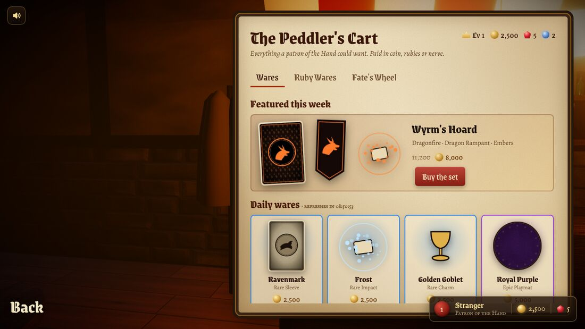
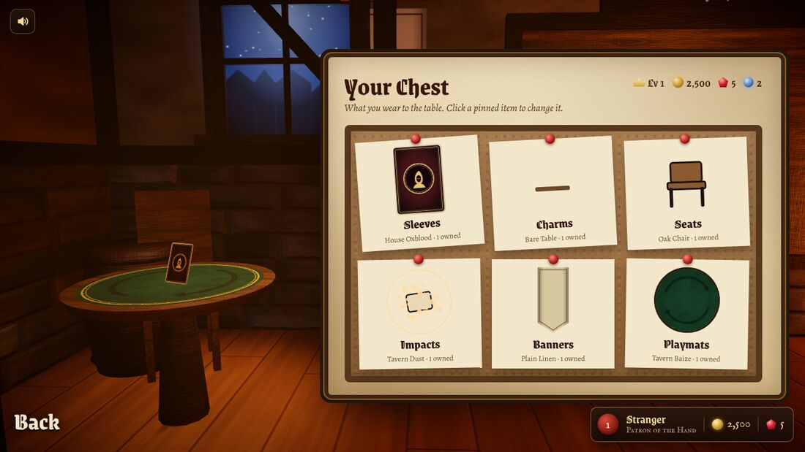

# The Hooded Hand

A candle-lit medieval tavern card game of nerve and treachery. Draw a card, and pray it is not the Hooded Hand.

- Plays in the browser (built for Chromebooks), fully 3D, all art and sound generated in code.
- 20 cards; tables for 2–6 players: Original, Duel, Teams (2v2), Winter Feast, Ranked, Scrimmage, Tutorial and
  spectating, all against bots for now. The engine and server are multiplayer-ready (Render blueprint included).
- Peddler's Cart shop, inventory with mutations, cosmetics (sleeves, playmats, death impacts, charms, chairs,
  banners), levels, daily and weekly challenges, ranked renown.

```bash
npm install
npm run dev     # http://localhost:5173
```

See **[HANDOFF.md](HANDOFF.md)** for architecture, deployment, status and next steps, and
**[docs/SESSION_CONTEXT.md](docs/SESSION_CONTEXT.md)** for the project's history and a starter prompt for a new chat.

| | |
|---|---|
|  |  |
|  |  |
|  |  |
